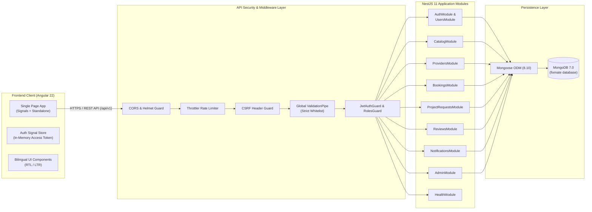
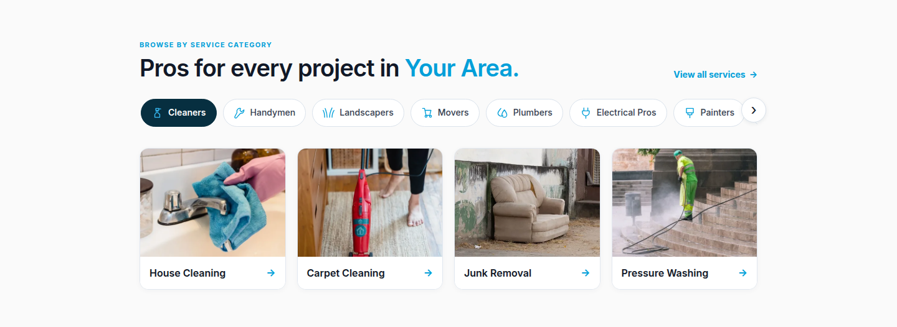
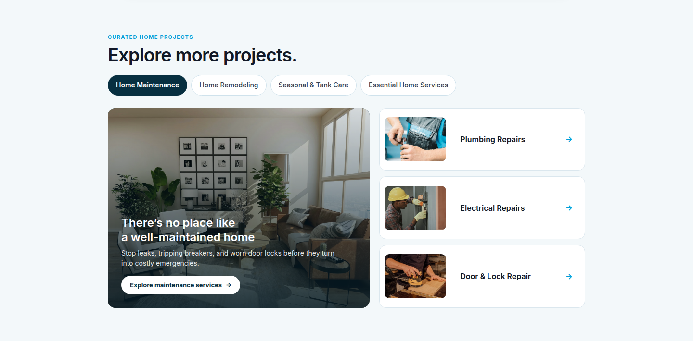

# FixMate

**A Full-Stack Home Services Marketplace for Jordan**

<p align="center">
  
</p>

FixMate is a modern, bilingual (Arabic & English), full-stack home services marketplace engineered specifically for the Jordanian market. It bridges the gap between household customers seeking reliable, upfront-priced maintenance services and vetted local service providers looking for scheduled job opportunities.

Built as a modular monolith using **Angular 22** on the frontend, **NestJS 11** on the backend, and **MongoDB 7**, FixMate incorporates robust security controls, discrete capacity scheduling, transparent pricing in Jordanian Dinars (`JOD`) / integer `fils`, and a high-performance, RTL-native user interface.

---

## 1. Project Overview

Finding and booking dependable home maintenance professionals in Jordan has traditionally relied on word-of-mouth recommendations, unpredictable pricing, and fragmented messaging apps. FixMate addresses these inefficiencies with an end-to-end digital platform tailored to local consumer habits and regulatory standards.

### How FixMate Works

1. **Discovery & Catalog Navigation:** Customers browse through a curated taxonomy of 15 service categories and 61 individual home maintenance services, complete with transparent pricing models (fixed price, hourly rates, or quote-based inspections).
2. **Vetted Provider Matching:** Customers can search providers by governorate, review credentials, check ratings, inspect verified service offerings, and select 30-minute availability slots.
3. **Structured Booking Lifecycle:** Bookings progress through deterministic state transitions (`REQUESTED` &rarr; `ACCEPTED` &rarr; `IN_PROGRESS` &rarr; `WORK_DONE` &rarr; `COMPLETED`), protecting both parties with capacity locking and transparent fulfillment tracking.
4. **Project Requests & Quotes:** For complex jobs requiring custom evaluation, customers submit detailed project requests with photos and requirements, receiving competitive quote proposals from qualified providers.
5. **Quality Assurance & Reviews:** Verified customers submit ratings and written reviews upon booking completion, directly driving provider reputation scores.

### Jordanian Market Context

- **Currency & Precision:** All monetary transactions and catalog prices are calculated using Jordanian Dinars (`JOD`) represented internally in integer **fils** (1 JOD = 1,000 fils) to eliminate floating-point rounding discrepancies.
- **Geographic Coverage:** Full support for Jordan's 12 governorates: Amman, Zarqa, Irbid, Aqaba, Balqa, Madaba, Jerash, Ajloun, Mafraq, Karak, Tafilah, and Ma'an.
- **Timezone Awareness:** All booking schedules, working hours, and capacity slots operate under the `Asia/Amman` timezone (UTC+3).
- **Bilingual First:** Seamless dual-language support with dynamic Arabic (Right-to-Left / RTL) and English (Left-to-Right / LTR) layouts, localized typography (`Noto Sans Arabic` and `Inter`), and bilingual database catalog entries.

---

## 2. Key Features

### Implemented & Verified Features

- **Authentication & Session Security:**
  - Secure registration, credential authentication, and session termination.
  - Short-lived HS256 JWT access tokens kept strictly in client memory.
  - Rotating `HttpOnly`, `SameSite=Lax` refresh cookies (`fm_refresh`) paired with database-backed session tracking and token replay/theft detection.
  - CSRF defense enforcing `Origin` and `X-Requested-With` header verification on mutating requests.
  - Password hashing utilizing `bcrypt` with 12 salt rounds.
- **Service Catalog Management:**
  - Hierarchical taxonomy comprising 15 categories and 61 maintenance services.
  - Search, category filtering, keyword querying, and sorting by popularity or price.
  - Administrative catalog management: create, update, and soft-archive services without disrupting historic booking records.
- **Provider Onboarding & Directory:**
  - Guided provider profile setup including business details, coverage zones, and verified bio.
  - Granular weekly schedule definition with 30-minute discrete time slots.
  - Custom service offerings mapped to the master catalog with provider-defined base pricing.
  - Provider verification lifecycle: `DRAFT` &rarr; `PENDING_REVIEW` &rarr; `APPROVED` / `REJECTED`.
  - Public directory enabling customers to filter providers by category, governorate, availability, and rating.
- **Deterministic Booking Engine:**
  - Direct booking creation against provider schedules.
  - Atomic capacity reservation on provider acceptance, preventing double-booking of 30-minute increments.
  - Explicit booking state machine: `REQUESTED`, `ACCEPTED`, `IN_PROGRESS`, `WORK_DONE`, `COMPLETED`, `REJECTED`, `CANCELLED`, `EXPIRED`.
- **Project Requests & Custom Quotes:**
  - Customer submission of open or targeted project requests with budgets and location details.
  - Provider quote submissions with line-item estimates and message proposals.
- **Reputation & Review System:**
  - Strict review gating: exactly one review permitted per completed booking.
  - Automatic re-aggregation of provider average rating and total review counts.
- **In-App Notifications:**
  - Real-time event notifications for booking state changes, quote offers, and moderation decisions.
  - User notification drawer with unread counts and read/dismiss actions.
- **Administrative Portal:**
  - Platform overview dashboard with operational metrics (user counts, active bookings, volume).
  - Provider onboarding moderation queue with approval and rejection workflows.
- **Bilingual, Responsive Interface:**
  - Built with Angular Signals and standalone components.
  - Fluid responsive layouts across mobile (360px, 390px), tablet (768px, 1024px), and desktop (1440px, 1792px).
  - Instant RTL/LTR switching with bi-directional CSS token architecture.

### Planned Future Enhancements

The following features represent intentional roadmap extensions beyond the current core platform scope:
- **Payment Gateway Integration:** Direct online card processing and CliQ mobile payments via licensed Jordanian payment service providers.
- **SMS & WhatsApp Dispatch:** External SMS / WhatsApp transactional delivery via local telecommunication gateways.
- **Real-Time Instant Messaging:** Live WebSocket chat between customers and providers during active bookings.
- **Live Geolocation Tracking:** Interactive map routing and live technician dispatch tracking.

---

## 3. User Roles

FixMate implements strict Role-Based Access Control (RBAC) across three distinct user roles:

| Role | Target Persona | Key Capabilities |
| :--- | :--- | :--- |
| **`CUSTOMER`** | Homeowners, tenants, and property managers | Browse services & providers, book appointments, submit project requests, receive provider quotes, track booking status, submit verified reviews, manage saved addresses. |
| **`PROVIDER`** | Independent technicians, tradespeople, & maintenance firms | Configure company/individual profile, set coverage governorates, configure custom service offerings and prices (in fils), define weekly 30-minute availability, accept/reject booking requests, submit quotes, manage ongoing jobs. |
| **`ADMIN`** | Platform operators and quality assurance managers | Review and approve/reject provider onboarding applications, manage category and service catalog entities (CRUD & soft-archiving), view platform analytics and operational metrics. |

---

## 4. Technology Stack

### Frontend Architecture
- **Framework:** [Angular 22](https://angular.dev/) (`^22.2.0`)
- **Language:** [TypeScript](https://www.typescriptlang.org/) (`~6.0.2`)
- **Reactive State:** Angular Signals & [RxJS](https://rxjs.dev/) (`~7.8.0`)
- **Styling:** SCSS with custom design token system (CSS custom properties, semantic color hierarchy, dynamic RTL/LTR support)
- **Unit Testing:** [Vitest](https://vitest.dev/) (`^5.0.0`) with [JSDOM](https://github.com/jsdom/jsdom) (`^30.0.0`)
- **End-to-End Verification:** [Playwright](https://playwright.dev/) (`^1.64.1`)

### Backend Architecture
- **Framework:** [NestJS 11](https://nestjs.com/) (`^11.0.0`) on [Express](https://expressjs.com/)
- **Language:** [TypeScript](https://www.typescriptlang.org/) (`^5.7.3`)
- **Database ODM:** [Mongoose](https://mongoosejs.com/) (`^8.10.0`)
- **Authentication:** [Passport](http://www.passportjs.org/) & [Passport-JWT](http://www.passportjs.org/packages/passport-jwt/) (`^4.0.1`), `@nestjs/jwt` (`^11.0.2`)
- **Cryptography:** [bcrypt](https://www.npmjs.com/package/bcrypt) (`^6.0.0`) (12 salt rounds)
- **Validation:** [class-validator](https://github.com/typestack/class-validator) (`^0.14.1`) & [class-transformer](https://github.com/typestack/class-transformer) (`^0.5.1`)
- **Security Middlewares:** [Helmet](https://helmetjs.github.io/) (`^8.0.0`), `@nestjs/throttler` (`^6.7.1`), custom CSRF origin check
- **Testing:** [Jest](https://jestjs.io/) (`^29.7.0`) & [Supertest](https://github.com/ladjs/supertest) (`^7.0.0`)

### Database & Infrastructure
- **Primary Database:** [MongoDB 7.0](https://www.mongodb.com/) (`mongo:7.0`)
- **Containerization:** Docker & Docker Compose v2 (`compose.yaml`)

---

## 5. System Architecture

FixMate is designed as a secure, modular monolith where distinct domain boundaries are maintained while avoiding distributed system overhead.



### Architectural Guarantees

1. **Token Separation:** Access tokens (15-minute TTL) are kept exclusively in memory and transmitted via the `Authorization: Bearer <token>` header. Refresh tokens (7-day TTL) reside in an `HttpOnly`, `SameSite=Lax` cookie (`fm_refresh`), ensuring credentials cannot be exfiltrated via XSS.
2. **Session Rotation & Theft Detection:** Every token refresh operation invalidates the prior refresh token in MongoDB, issuing a new refresh token and access token. Attempting to reuse an invalidated refresh token immediately revokes all active sessions for that user.
3. **Discrete Availability Model:** Provider capacity is partitioned into atomic 30-minute blocks (`HH:mm`). Acceptance of a booking locks capacity across requested increments, preventing concurrency overbooking.

---

## 6. Repository Structure

```text
FixMate/
├── backend/                        # NestJS 11 REST API Application
│   ├── src/
│   │   ├── config/                 # Environment validation and typing
│   │   ├── database/               # Mongoose connection & configuration
│   │   ├── common/                 # Guards, decorators, filters, interceptors
│   │   ├── modules/
│   │   │   ├── auth/               # Authentication, token rotation, sessions
│   │   │   ├── users/              # User entity, profile, address management
│   │   │   ├── catalog/            # Categories & services taxonomy
│   │   │   ├── providers/          # Provider profile, schedules, offerings
│   │   │   ├── bookings/           # Booking lifecycle & slot management
│   │   │   ├── project-requests/   # Custom requests & quote proposals
│   │   │   ├── reviews/            # Reviews & rating aggregation
│   │   │   ├── notifications/      # In-app notifications
│   │   │   ├── admin/              # Admin overview & moderation
│   │   │   └── health/             # Health checks (/api/v1/health)
│   │   └── scripts/
│   │       ├── seed-catalog.ts     # Additive catalog seeder (15 cats, 61 services)
│   │       ├── seed-demo.ts        # Idempotent demo account generator
│   │       └── bootstrap-admin.ts  # Headless admin bootstrapping utility
│   ├── test/                       # End-to-end integration test suites
│   ├── .env.example                # Backend environment reference
│   ├── package.json
│   └── tsconfig.json
├── frontend/                       # Angular 22 Standalone Single-Page Application
│   ├── src/
│   │   ├── app/
│   │   │   ├── core/               # Auth store, HTTP interceptors, guards
│   │   │   ├── features/           # Feature pages (Public, Auth, Dashboards)
│   │   │   ├── shared/             # Reusable UI components & dialogs
│   │   │   ├── app.config.ts       # Application routing and client providers
│   │   │   └── app.routes.ts       # Route declarations
│   │   ├── assets/                 # Translation JSONs and local assets
│   │   └── public/                 # Static assets, branding, and hero imagery
│   │       ├── brand/              # FixMate brand logos and icons
│   │       ├── images/hero/        # Optimized WebP hero slideshow scenes
│   │       └── catalog/            # Discovery taxonomy definitions
│   ├── .env.example                # Frontend environment reference
│   ├── package.json
│   └── tsconfig.json
├── docs/                           # Architecture specs, PRD, and audit reports
├── compose.yaml                    # Docker Compose configuration (MongoDB 7.0)
├── .gitignore                      # Git exclusion rules
└── README.md                       # Project documentation
```

---

## 7. Prerequisites

Before setting up FixMate locally, ensure your machine has the following tools installed:

- **Node.js:** `v20.x` or `v22.x` LTS
- **npm:** `v10.x` or higher
- **Docker & Docker Compose:** Docker Desktop or Docker Engine v24+ with Compose v2
- **Git:** `v2.40+`

---

## 8. Installation & Local Development

Follow these steps to run the complete FixMate stack locally.

### Step 1: Clone the Repository

```bash
git clone <repository-url>
cd FixMate
```

### Step 2: Configure Environment Files

Create the backend environment file from the provided example:

```bash
cp backend/.env.example backend/.env
```

*(Optional)* Review `backend/.env` to confirm the default local values:
- `PORT=3000`
- `NODE_ENV=development`
- `MONGODB_URI=mongodb://127.0.0.1:27017/fixmate`
- `JWT_ACCESS_SECRET` contains a development secret string.

### Step 3: Install Dependencies

Install dependencies for both frontend and backend:

```bash
npm install --prefix backend
npm install --prefix frontend
```

### Step 4: Start MongoDB

Launch the local MongoDB 7.0 instance using Docker Compose:

```bash
docker compose up -d mongodb
```

Verify that MongoDB is running and healthy:

```bash
docker compose ps
```

### Step 5: Seed the Service Catalog

Populate the database with FixMate's 15 categories and 61 localized home services:

```bash
npm run seed:catalog --prefix backend
```

### Step 6: Seed Local Demo Accounts

Generate the standard development demo accounts:

```bash
ALLOW_DEMO_ACCOUNT_SEED=true npm run seed:demo --prefix backend
```

> [!NOTE]
> This command creates the verified `ADMIN`, `CUSTOMER`, and `PROVIDER` accounts and generates strong local credentials in `backend/.env.demo.local`. See [Section 10: Demo Accounts](#10-demo-accounts) for details.

### Step 7: Start Backend Server

Start the NestJS API server in development mode:

```bash
npm run start:dev --prefix backend
```

The API will be available at `http://localhost:3000/api/v1`.
You can verify backend health by visiting: `http://localhost:3000/api/v1/health`.

### Step 8: Start Frontend Application

In a separate terminal window, launch the Angular development server:

```bash
npm run start --prefix frontend
```

Navigate your browser to: **`http://localhost:4200`**.

---

## 9. Environment Configuration

### Backend Variables (`backend/.env`)

| Variable | Required | Type | Default / Example | Purpose |
| :--- | :---: | :--- | :--- | :--- |
| `NODE_ENV` | Yes | `string` | `development` | Runtime environment (`development`, `test`, `production`). |
| `PORT` | Yes | `number` | `3000` | HTTP port for the NestJS application server. |
| `CORS_ORIGINS` | Yes | `string` | `http://localhost:4200` | Comma-separated list of allowed browser origins for CORS. |
| `MONGODB_URI` | Yes | `string` | `mongodb://127.0.0.1:27017/fixmate` | Connection URI for the MongoDB instance. |
| `JWT_ACCESS_SECRET` | Yes | `string` | *(32+ char secret)* | Secret key used to sign HS256 JWT access tokens. |
| `JWT_ACCESS_TTL_SECONDS`| No | `number` | `900` | Access token lifespan in seconds (default: 15 minutes). |
| `REFRESH_SESSION_TTL_DAYS`| No | `number` | `7` | Refresh cookie session duration in days (default: 7 days). |

### Frontend Variables (`frontend/src/environments/`)

| Variable | File | Default Value | Purpose |
| :--- | :--- | :--- | :--- |
| `API_BASE_URL` | `environment.development.ts` | `http://localhost:3000/api/v1` | Target URL prefix for all backend REST endpoints. |
| `DEFAULT_LANGUAGE` | `environment.ts` | `ar` | Initial application language (`ar` or `en`). |
| `MARKET_TIMEZONE` | `environment.ts` | `Asia/Amman` | Local marketplace timezone for date rendering. |
| `CURRENCY_CODE` | `environment.ts` | `JOD` | Display currency code. |

---

## 10. Demo Accounts

FixMate provides an automated, idempotent demo account seeding script designed specifically for local evaluation and testing across all three user roles.

### Standard Demo Accounts

| Role | Email Address | Default Target Route | Role Permissions & Responsibilities |
| :--- | :--- | :--- | :--- |
| **`ADMIN`** | `admin.demo@fixmate.test` | `/dashboard/admin` | Platform metrics oversight, provider onboarding verification/approval, service catalog management. |
| **`CUSTOMER`** | `customer.demo@fixmate.test` | `/dashboard/customer` | Marketplace search, direct bookings, project requests, quote review, address book management. |
| **`PROVIDER`** | `provider.demo@fixmate.test` | `/dashboard/provider` | Approved profile in Amman, custom service offerings, 30-min schedule management, booking acceptance. |

### Demo Credentials Management (`backend/.env.demo.local`)

On first execution of the demo seeder, strong, distinct 20+ character passwords (`Fm!A1-...`) are generated and recorded into a local environment file:

```text
backend/.env.demo.local
```

- **File Permissions:** Created with strict owner-only permissions (`chmod 0600`).
- **Version Control:** Explicitly excluded in `.gitignore` — **never committed to version control**.
- **Evaluator Access:** Developers and evaluators can inspect this file locally to obtain passwords for testing:
  ```bash
  cat backend/.env.demo.local
  ```
- **Optional Password Overrides:** Developers may supply custom passwords prior to running the seed script via environment variables:
  ```bash
  DEMO_ADMIN_PASSWORD="YourPassword123!" \
  DEMO_CUSTOMER_PASSWORD="YourPassword123!" \
  DEMO_PROVIDER_PASSWORD="YourPassword123!" \
  ALLOW_DEMO_ACCOUNT_SEED=true npm run seed:demo --prefix backend
  ```

### Seed Guardrails & Idempotency

The demo seeder incorporates strict safety checks to prevent misuse:
- **Production Refusal:** Immediately aborts if `NODE_ENV=production`.
- **Explicit Flag Requirement:** Requires `ALLOW_DEMO_ACCOUNT_SEED=true` on every execution.
- **Database Scope Restrictions:** Only permits connections to loopback hosts (`localhost`, `127.0.0.1`) and database names matching `fixmate`, `fixmate_dev`, `fixmate_development`, or `fixmate_test`.
- **Non-Destructive Idempotency:** Running the command repeatedly preserves existing account IDs, password hashes, and provider profile customizations without dropping collections.

---

## 11. Testing

FixMate maintains test coverage across both frontend and backend codebases.

### Backend Tests

Execute NestJS unit and integration test suites:

```bash
# Run unit and service tests in-band
npm test --prefix backend -- --runInBand

# Run backend linter
npm run lint --prefix backend

# Execute production TypeScript build check
npm run build --prefix backend
```

### Frontend Tests

Execute Angular component and store unit tests:

```bash
# Run frontend unit tests via Vitest
npm test --prefix frontend -- --watch=false

# Execute production Angular build check
npm run build --prefix frontend
```

---

## 12. Screenshots

Tracked interface captures illustrating FixMate's responsive design and bilingual interface:

| View | English (LTR) | Arabic (RTL) |
| :--- | :---: | :---: |
| **Hero & Marketplace Discovery** |  |  |
| **Service Catalog Explorer** |  | *(Dynamic RTL mirror)* |
| **Project Requests & Quote Matching**|  | *(Dynamic RTL mirror)* |

---

## 13. Localization

FixMate is designed from the foundation as a first-class bilingual application tailored for Jordan:

- **Primary Language (Arabic):** Arabic (`ar`) is the default locale. The interface adopts a natural Right-to-Left (`dir="rtl"`) flow with typography rendered in the `Noto Sans Arabic` typeface.
- **Secondary Language (English):** English (`en`) provides a Left-to-Right (`dir="ltr"`) flow using `Inter`.
- **Dynamic Layout Mirroring:** Switching languages updates `<html lang="..." dir="...">` dynamically. SCSS design tokens utilize logical properties (`margin-inline-start`, `inset-inline-end`) ensuring correct spacing, navigation bars, cards, and modal alignments across both reading directions.
- **Bilingual Database Schemas:** Service catalog items, category names, descriptions, and notifications store localized strings for both `ar` and `en`.

---

## 14. Security Architecture

FixMate enforces multi-layered defense-in-depth across the application lifecycle:

1. **Password Hashing:** User passwords are encrypted using `bcrypt` with 12 salt rounds before database persistence.
2. **In-Memory JWT Access Tokens:** Short-lived access tokens (15-minute expiration) are held strictly within an Angular Signal store in client memory, preventing exposure to browser storage (Local/SessionStorage).
3. **Rotating `HttpOnly` Refresh Cookies:** Refresh tokens (7-day lifespan) are issued in secure, `HttpOnly`, `SameSite=Lax` cookies named `fm_refresh`. The backend maintains active session records in MongoDB, rotating both tokens on every renewal.
4. **Token Replay & Theft Detection:** If an invalidated or already-rotated refresh token is presented, the authentication engine flags a replay attack and revokes all active sessions belonging to that user account.
5. **CSRF Mitigation:** All state-mutating requests (`POST`, `PUT`, `PATCH`, `DELETE`) are subject to CSRF origin verification, requiring matching `Origin` headers and a custom `X-Requested-With` header.
6. **Role-Based Access Control:** Every protected route is guarded by `JwtAuthGuard` and `RolesGuard`, strictly enforcing `CUSTOMER`, `PROVIDER`, and `ADMIN` boundaries at the controller level.
7. **HTTP Security Headers:** Integrated [Helmet](https://helmetjs.github.io/) middleware configures Content Security Policy (CSP), HTTP Strict Transport Security (HSTS), X-Frame-Options (`DENY`), and X-Content-Type-Options (`nosniff`).
8. **Rate Limiting:** NestJS Throttler protects authentication endpoints (`/auth/login`, `/auth/register`, `/auth/refresh`) against brute-force and credential-stuffing attacks.
9. **Strict Payload Validation:** The global NestJS `ValidationPipe` operates with `whitelist: true`, `forbidNonWhitelisted: true`, and `transform: true` to strip undeclared payload properties.
10. **Integer Financial Arithmetic:** All catalog pricing, quotes, and booking amounts are processed in integer `fils` (1/1000 JOD) to ensure absolute precision and prevent IEEE 754 floating-point rounding vulnerabilities.

---

## 15. Project Status

FixMate is currently in active development as a fully functional core platform MVP.

- **Core Platform:** Complete and verified (Authentication, Catalog, Onboarding, Directory, Bookings, Quotes, Reviews, In-App Notifications, Admin Moderation).
- **Quality Gates:** Fully passed frontend and backend unit tests, production compilation builds, and browser verification across viewports.
- **Deployment Readiness:** Pre-configured for Docker Compose local execution and modular containerized deployment.

---

## 16. License

This repository is private and proprietary.
**UNLICENSED** &copy; 2026 FixMate. All rights reserved.

Unauthorized copying, modification, distribution, or commercial use of this software, via any medium, is strictly prohibited.
