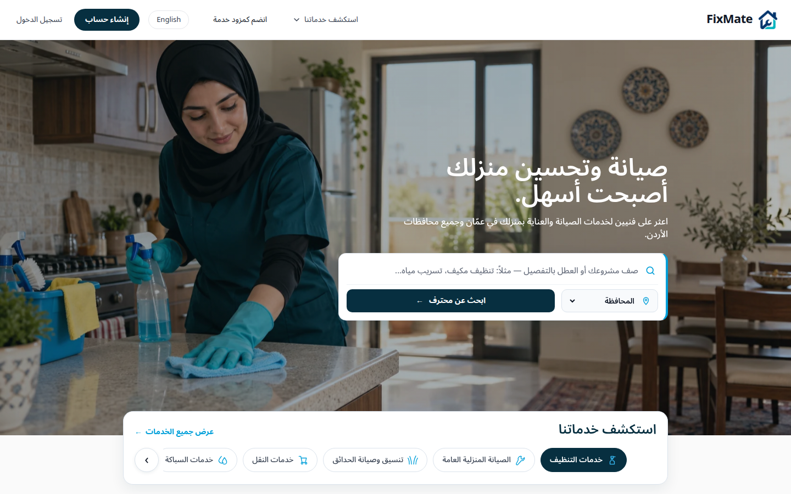
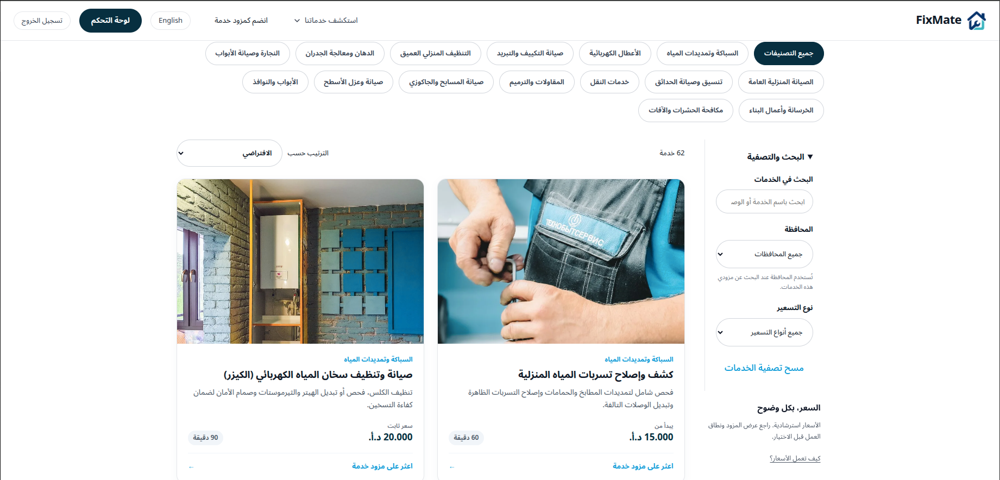
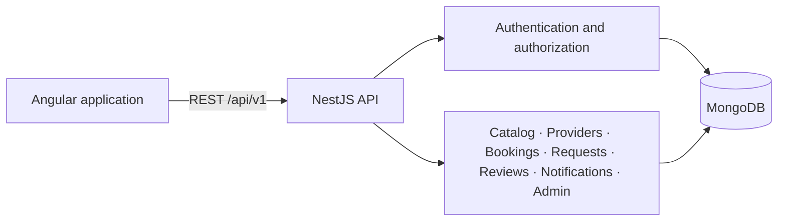

<p align="center">
  
</p>

<h1 align="center">FixMate</h1>

<p align="center">
  <strong>Home services, built around everyday life in Jordan.</strong><br />
  A bilingual marketplace for finding professionals, requesting services, and managing home-maintenance appointments.
</p>

<p align="center">
  Angular 22 · NestJS 11 · MongoDB 7 · TypeScript · Arabic RTL / English LTR
</p>

---

## Overview

FixMate connects customers with home-service professionals across Jordan. Customers can explore services and approved provider listings, request an appointment, or describe a project to a selected provider. Professionals manage their profiles, offerings, coverage areas, working hours, and service requests. Administrators manage the catalog, review provider applications, and oversee platform activity.

The application uses a standalone Angular frontend and a modular NestJS REST API backed by MongoDB. Arabic and English are supported throughout the interface, with Jordanian governorates, `Asia/Amman` scheduling, and prices represented in integer **fils**: **1 JOD = 1,000 fils**.

**Status:** actively developed application with implemented customer, provider, and administrator workflows. A successful production build is a compilation check, not a claim that a public deployment or production operations setup is complete.

## Application preview

### Homepage · الصفحة الرئيسية

The Arabic homepage brings service photography, project search, governorate selection, and category discovery into one flow.



### Service catalog · دليل الخدمات

Customers can browse service categories, search the catalog, filter by governorate and pricing type, and open individual services.



These screenshots show the development application. Displayed prices are indicative catalog values, not guarantees of a final provider quotation.

## Contents

- [Application preview](#application-preview)
- [Features](#features)
- [Roles and workflows](#roles-and-workflows)
- [Technology and architecture](#technology-and-architecture)
- [Local setup](#local-setup)
- [Development accounts](#development-accounts)
- [Configuration](#configuration)
- [Development and verification](#development-and-verification)
- [Security model](#security-model)
- [Production considerations](#production-considerations)
- [Documentation](#documentation)
- [Scope and limitations](#scope-and-limitations)
- [Branding and asset provenance](#branding-and-asset-provenance)

## Features

### Service discovery

- Searchable service catalog with category, pricing-type, and sorting controls.
- **14 homepage category selectors and 56 featured service examples**, driven by the shared discovery taxonomy. The backend catalog also retains additional and legacy entries.
- Provider directory with service, category, governorate, and area filters, plus public provider profiles.
- Bilingual service details and indicative pricing where catalog data supports it. Services without published pricing show a quotation state rather than an invented amount.
- Responsive homepage with seven service-based hero scenes, reduced-motion support, integrated category navigation, How It Works, project exploration, and resource guides.

### Accounts and professional onboarding

- Customer and provider registration, login, session refresh, logout, and account-profile management.
- Provider profiles with bilingual biographies, coverage areas, weekly availability, and service offerings.
- Administrator approval before a provider listing becomes publicly available.
- Separate account status and provider approval status: being able to log in does not automatically make a provider publicly listed.

### Requests, bookings, and reviews

- Direct appointment requests with provider acceptance, rejection, cancellation, and work-progress tracking.
- Provider capacity represented by discrete 30-minute slots, with reservation checks to prevent overlapping accepted bookings.
- Project requests addressed to a selected provider, with a written response or decline. These are separate from appointment bookings.
- Customer reviews tied to completed bookings, with provider rating aggregation and review moderation.
- Persistent in-app notifications for supported booking, approval, and review events, with read-state management.
- Administrator views for operational metrics, accounts, catalog management, and provider moderation.

## Roles and workflows

| Role | Main capabilities | Workspace |
| --- | --- | --- |
| **CUSTOMER** | Browse services and providers, manage addresses, request appointments or projects, track work, and review completed bookings | `/dashboard/customer` |
| **PROVIDER** | Complete onboarding, manage offerings and schedules, respond to project requests, and manage appointment work | `/dashboard/provider` |
| **ADMIN** | Manage catalog and account status, review provider listings, and inspect platform activity | `/dashboard/admin` |

Administrators are provisioned through the existing CLI bootstrap; public registration cannot grant the `ADMIN` role.

The main booking progression is:

```text
REQUESTED → ACCEPTED → IN_PROGRESS → WORK_DONE → COMPLETED
```

Rejection, cancellation, and expiry follow the applicable state-transition rules. Provider onboarding follows `DRAFT → PENDING_REVIEW → APPROVED`, with rejection and suspension supported by administrative moderation.

## Technology and architecture

| Layer | Implementation |
| --- | --- |
| Frontend | Angular 22, standalone components, Signals, RxJS, TypeScript, SCSS |
| Backend | NestJS 11, Express, TypeScript, modular domain services |
| Persistence | MongoDB 7 and Mongoose 8 |
| Authentication | Passport/JWT, bcrypt, database-backed refresh sessions |
| Validation | `class-validator`, `class-transformer`, NestJS validation pipes |
| Testing | Vitest/JSDOM, Jest/Supertest, Playwright browser verification |
| Local infrastructure | Docker Compose for MongoDB; optional Redis profile |



```text
FixMate/
├── backend/
│   ├── src/common/          # Authentication guards and domain rules
│   ├── src/database/        # Mongoose schemas and persistence modules
│   ├── src/modules/         # Application domains and REST endpoints
│   ├── src/scripts/         # Catalog seed, admin bootstrap, demo accounts
│   └── .env.example
├── frontend/
│   ├── src/app/             # Routes, features, layouts, and shared UI
│   ├── src/environments/    # Development and production API settings
│   ├── public/              # Logo, fonts, images, and discovery taxonomy
│   └── tools/               # Browser verification scripts
├── docs/                    # Architecture, contracts, research, and verification
└── compose.yaml             # Local MongoDB and optional Redis
```

## Local setup

**تشغيل المشروع محليًا — خطوة بخطوة**

The application needs **three running services**: MongoDB, the NestJS backend, and the Angular frontend. Docker starts MongoDB in the background; run the backend and frontend in **two separate terminals**.

| Service | Address | How it runs |
| --- | --- | --- |
| MongoDB | `127.0.0.1:27017` | Docker container or an existing local MongoDB instance |
| Backend | `http://localhost:3000/api/v1` | Terminal 1, kept open |
| Frontend | `http://localhost:4200` | Terminal 2, kept open |

### Prerequisites

- **Node.js 24.15 or newer within the 24.x line**, and **npm 11**. The installed Angular packages also support Node `^22.22.3` or `>=26.0.0`; Node 24 is the documented local-development choice.
- Docker with Docker Compose, or an existing local MongoDB 7 instance.
- Git. Browser verification scripts additionally require a compatible Chromium installation.

Check the tools before starting:

```bash
node --version
npm --version
docker compose version
```

Commands below use a Bash-compatible shell. Unless stated otherwise, run them from the **repository root**: the folder containing `backend/`, `frontend/`, and `compose.yaml`.

### 1. Open the repository

For a new checkout:

```bash
git clone https://github.com/FixMate-web/FixMate.git
cd FixMate
```

**Already have the project?** Open a terminal in your existing `FixMate` folder and continue with step 2. Do not clone a second copy or create a new GitHub repository.

### 2. Install backend and frontend dependencies

```bash
npm ci --prefix backend
npm ci --prefix frontend
```

There is no root application install command. Each application has its own `package.json` and lockfile. Wait for both installations to finish before continuing.

### 3. Start and check MongoDB

```bash
docker compose up -d mongodb
docker compose ps mongodb
```

Wait until the database container is running and healthy before seeding. MongoDB data is stored in a named Docker volume and survives a container stop/restart. Redis is optional and is not required for the current core workflows.

If you already run a local MongoDB instance on port `27017`, you can use it instead of starting another database container. The connection URI in the next step must point to that instance.

### 4. Configure the backend environment

Create the local configuration without overwriting an existing file:

```bash
cp -n backend/.env.example backend/.env
```

Open `backend/.env` in your editor. For the default local setup, confirm these values:

```dotenv
NODE_ENV=development
PORT=3000
MONGODB_URI=mongodb://127.0.0.1:27017/fixmate
CORS_ORIGINS=http://localhost:4200
```

Generate a fresh signing secret:

```bash
node -e "console.log(require('node:crypto').randomBytes(48).toString('hex'))"
```

Copy the generated value into `JWT_ACCESS_SECRET` in **your local `backend/.env`**, replacing the example value. Keep the existing `JWT_ACCESS_TTL_SECONDS` and `REFRESH_SESSION_TTL_DAYS` settings unless you intentionally need different lifetimes.

Do not put the generated secret in this README or commit the local environment file.

### 5. Populate the catalog and create local test accounts

MongoDB must be running. The API server does **not** need to be started yet.

```bash
npm run seed:catalog --prefix backend
ALLOW_DEMO_ACCOUNT_SEED=true npm run seed:demo --prefix backend
```

The first command populates the existing service catalog. The second creates the administrator, customer, and provider accounts described in [Development accounts](#development-accounts).

Open **`backend/.env.demo.local`** in your local editor to find each email and its generated password. This private, Git-ignored file is for local testing only. A repeated seed run reuses the accounts and credentials rather than resetting the database.

**Using a different MongoDB URI?** The catalog seed and standalone admin bootstrap read `MONGODB_URI` from the shell environment, falling back to the default local `fixmate` database. Export the same URI you configured in `backend/.env` before running those commands. The API and demo-account seed load the backend environment file themselves.

### 6. Start the backend — Terminal 1

From the repository root:

```bash
npm run start:dev --prefix backend
```

Wait for NestJS to finish starting. **Leave this terminal open.** It runs the API and watches backend source files for changes.

Open `http://localhost:3000/api/v1/health` in your browser, or check it from another terminal:

```bash
curl --fail http://localhost:3000/api/v1/health
```

The response should include `"status":"ok"` and a connected database status. If this check fails, resolve the backend/database issue before testing frontend login.

### 7. Start the frontend — Terminal 2

Open a **second terminal**, navigate to the same repository root, and run:

```bash
npm start --prefix frontend
```

Wait for Angular to finish compiling. **Leave this terminal open too.** Visit:

- Website: **http://localhost:4200**
- Login: **http://localhost:4200/auth/login**

The Angular development environment calls `http://localhost:3000/api/v1` directly. Use `localhost` consistently for the frontend and API when testing cookie sessions; switching one of them to `127.0.0.1` changes the browser origin/site relationship.

### 8. Sign in and check the three experiences

Use the emails and passwords from `backend/.env.demo.local`. After a normal login, the application opens the appropriate workspace:

| Test role | Workspace | What to check first |
| --- | --- | --- |
| ADMIN | `/dashboard/admin` | Provider moderation, then the catalog/overview links |
| CUSTOMER | `/dashboard/customer` | Customer workspace, services, and addresses |
| PROVIDER | `/dashboard/provider` | Approved demo profile and its existing service offering |

Log out before switching accounts, or use separate browser profiles. The demo provider is a **test fixture**, not a real professional; do not use it for real customer requests.

### Running the project again

You do not need to reinstall dependencies or recreate accounts on every launch:

1. Start MongoDB if it is stopped: `docker compose up -d mongodb`.
2. Run the backend command from step 6 in Terminal 1.
3. Run the frontend command from step 7 in Terminal 2.
4. Open `http://localhost:4200`.

Run `npm ci` again when you need to install changed lockfile dependencies. Run the catalog seed when updating seeded catalog data. Existing demo credentials remain in the local credential file.

To stop development, press **Ctrl+C** in each application terminal. If you also want to stop the database container while preserving its data:

```bash
docker compose stop mongodb
```

### Common startup issues

| Symptom | Check |
| --- | --- |
| MongoDB connection refused or server-selection timeout | Confirm MongoDB is running and that `MONGODB_URI` points to the correct host/port. |
| Database port `27017` is already in use | Use the existing local MongoDB instance, or configure one consistent alternative URI for the API and seeds. |
| Backend fails environment validation | Check `backend/.env`, especially `MONGODB_URI`, `CORS_ORIGINS`, and `JWT_ACCESS_SECRET`. Restart the backend after editing configuration. |
| Frontend loads but services or login fail | Open the API health URL first; then check that the backend is running and its port matches `environment.development.ts`. |
| Login reports invalid credentials | Use the exact email/password pair from `backend/.env.demo.local`; confirm the demo seed targeted the same database as the running API. |
| Login works but the session disappears after reload | Check consistent hostnames, the allowed frontend origin, and browser cookie settings. |
| Port `3000` or `4200` is occupied | Check whether another copy of the development server is already running. If you change a port, update the related API URL or CORS configuration too. |
| `ng` is not found as a global command | Use `npm start --prefix frontend`; the project uses its locally installed Angular CLI. |

<details>
<summary><strong>ملخّص التشغيل بالعربي</strong></summary>

1. افتح التيرمنال داخل مجلد المشروع الذي يحتوي على `backend` و`frontend`.
2. ثبّت المكتبات للباك إند والفرونت إند باستخدام أوامر الخطوة الثانية، إذا لم تكن مثبتة.
3. شغّل MongoDB وتأكد أنه جاهز قبل تشغيل أوامر تعبئة البيانات.
4. جهّز ملف `backend/.env`، وضع فيه مفتاح JWT عشوائيًا بدل القيمة الافتراضية.
5. نفّذ أمر تعبئة الخدمات، ثم أمر إنشاء الحسابات التجريبية. بيانات الدخول موجودة محليًا في `backend/.env.demo.local`.
6. شغّل الباك إند في تيرمنال مستقل، وتأكد أن رابط فحص الصحة يعمل.
7. شغّل الفرونت إند في تيرمنال ثانٍ، واترك التيرمنالين مفتوحين.
8. افتح `http://localhost:4200`، وسجّل الدخول بالحساب المناسب. عند التشغيل لاحقًا لا تحتاج إلى إنشاء الحسابات من جديد.

</details>

## Development accounts

The opt-in demo seed creates these **local test accounts**, with distinct generated passwords:

| Email | Role |
| --- | --- |
| `admin.demo@fixmate.test` | ADMIN |
| `customer.demo@fixmate.test` | CUSTOMER |
| `provider.demo@fixmate.test` | PROVIDER |

Credentials are recorded in **`backend/.env.demo.local`**, which is Git-ignored and created with owner-only read/write permissions. Passwords are never printed by the seed or stored as plaintext in MongoDB. Do not commit, share, or include this file in a deployment.

```bash
ALLOW_DEMO_ACCOUNT_SEED=true npm run seed:demo --prefix backend
```

The demo seed:

- Requires explicit opt-in on every run and **always refuses production**.
- Accepts only loopback MongoDB targets with supported FixMate development/test database names.
- Reuses account IDs and credentials; refuses conflicting roles, statuses, or passwords instead of resetting existing accounts.
- Uses the existing admin bootstrap, registration service, and provider submission/approval workflow.
- Creates a clearly labeled test provider with an existing plumbing offering and catalog-derived pricing, zero reviews, and no seeded bookings.
- Preserves an approved demo profile's edits and does not silently reverse a rejection or suspension.

Explicit `DEMO_ADMIN_PASSWORD`, `DEMO_CUSTOMER_PASSWORD`, and `DEMO_PROVIDER_PASSWORD` environment variables can supply credentials instead of generated values. They must be distinct and meet the seed's strength requirements; existing accounts must already match them.

For a separate administrator account, use `npm run bootstrap:admin --prefix backend` with `ADMIN_BOOTSTRAP_EMAIL`, `ADMIN_BOOTSTRAP_PASSWORD`, and optionally `ADMIN_BOOTSTRAP_NAME` supplied securely through the environment. The existing bootstrap has its own production restrictions; do not use demo provisioning in production.

## Configuration

| Setting | Purpose | Local example/default |
| --- | --- | --- |
| `NODE_ENV` | Runtime environment | `development` |
| `PORT` | NestJS listening port | `3000` |
| `MONGODB_URI` | Database connection | `mongodb://127.0.0.1:27017/fixmate` |
| `CORS_ORIGINS` | Comma-separated allowed browser origins | `http://localhost:4200` |
| `JWT_ACCESS_SECRET` | Access-token signing secret | Supply a unique random secret |
| `JWT_ACCESS_TTL_SECONDS` | Access-token lifetime | `900` |
| `REFRESH_SESSION_TTL_DAYS` | Refresh-session lifetime | `7` |

Frontend API and locale settings live in `frontend/src/environments/`. Development uses the local API URL; production uses the relative `/api/v1` path. Supported pricing types are `FIXED`, `STARTING_AT`, and `INSPECTION_ONLY`; an absent catalog pricing policy is handled separately as quotation-only discovery.

## Development and verification

Run the current checks rather than relying on historical test counts in older reports:

```bash
# Backend compilation and tests
npm run build --prefix backend
npm test --prefix backend -- --runInBand

# Frontend production compilation and tests
npm run build --prefix frontend
npm test --prefix frontend -- --watch=false
```

Backend integration tests need local MongoDB and use test databases. Run them only against development/test infrastructure. Frontend browser checks require both applications to be running:

```bash
node frontend/tools/service-hero-review.cjs
```

This script checks the seven-scene slideshow loop, responsive layouts, bilingual rendering, image loading, and zoom continuity. It uses `/usr/bin/google-chrome` by default; set `CHROME_PATH` for a different compatible executable. Results are saved under `artifacts/service-heroes/`.

Other scripts in `frontend/tools/` and older verification reports may target earlier UI snapshots. Review their selectors and assumptions before treating them as current regression checks.

## Security model

- Passwords use **bcrypt with cost 12**.
- Short-lived JWT access tokens are held in frontend memory, not browser local/session storage.
- Refresh sessions use the **`fixmate_rt` HttpOnly cookie**, database-backed rotation, and replay detection. The cookie is scoped to `/api/v1/auth`, uses `SameSite=Lax`, and is marked `Secure` in production.
- Cookie-based refresh and logout require the `X-Requested-With: FixMateClient` header and an allowed origin (or Referer); production requires one of these origin headers.
- Server-side JWT, role, account-status, and ownership checks enforce authorization. Angular guards provide navigation behavior, not the security boundary.
- CORS, Helmet, strict DTO validation, and authentication-endpoint throttling provide additional controls.
- Provider listing approval does not claim government certification, insurance, background clearance, or guaranteed workmanship.

Logout revokes the refresh-session family and clears the client's in-memory token. An already issued access token remains subject to its short expiry and the API's live account-status checks.

## Production considerations

Deployment configuration for Atlas, Render and Vercel is included. Follow the [deployment guide](docs/DEPLOYMENT_GUIDE.md) for account setup, initialization and live verification:

- Use production secrets and an appropriate MongoDB deployment; do not copy local environment files or demo data.
- Route frontend `/api/v1` requests to NestJS. Configure SPA fallbacks for frontend routes without intercepting API requests.
- Use HTTPS, production cookie settings, and the correct CORS allowlist. An arbitrary cross-site frontend/API pairing can prevent refresh cookies from working; prefer an appropriate same-site or same-origin arrangement.
- Start the compiled backend with `npm run start:prod --prefix backend` after building. Angular browser output is under `frontend/dist/fixmate-frontend/browser/`.
- Configure monitoring, backups, resource limits, and operational maintenance for the chosen hosting environment.

`compose.yaml` provisions local database services; it is not a complete containerized production deployment of the frontend and backend.

## Documentation

| Topic | Reference |
| --- | --- |
| Product scope and architecture | [PRD](docs/01-product/PRD.md), [Architecture](docs/01-product/ARCHITECTURE.md), [Decisions](docs/01-product/DECISIONS.md) |
| Authentication and sessions | [Authentication design](docs/AUTH_DESIGN.md) |
| Provider onboarding | [Provider onboarding and approval](docs/PROVIDER_ONBOARDING.md) |
| API reference | [Phase 2 API contract](docs/PHASE2_API_CONTRACT.md) |
| Booking rules | [Booking lifecycle](docs/01-product/BOOKING_LIFECYCLE.md), [Booking verification](docs/PHASE3_BOOKING_VERIFICATION.md) |
| Dashboards and notifications | [Dashboard verification](docs/PHASE4_DASHBOARDS_VERIFICATION.md), [Notifications verification](docs/PHASE5_ADVANCED_VERIFICATION.md) |
| Jordanian pricing | [Pricing research and assumptions](docs/jordan-service-pricing-research.md) |
| Design and photography | [Design system](docs/02-ui/DESIGN_SYSTEM.md), [Image sources](docs/image-sources.md), [Discovery image sources](docs/discovery-image-sources.md) |
| Deployment | [Atlas / Render / Vercel guide](docs/DEPLOYMENT_GUIDE.md), [current verification](docs/DEPLOYMENT_VERIFICATION.md) |

Some documents describe earlier development phases. Their feature lists, counts, and deployment examples are historical context; current source code, package scripts, and executable tests determine actual behavior.

## Scope and limitations

The current implementation does **not** provide online payments, live WebSocket chat, technician location tracking, external SMS/WhatsApp delivery, or production email delivery. Provider responses to project requests are written responses, not a separate competitive-bidding or itemized-quotation engine. Project-photo uploads and credential-document verification are not implemented in these flows.

Empty provider results, unpublished pricing, and missing reviews are represented explicitly. Demo providers are for local testing and must not be presented as real service professionals.

## Branding and asset provenance

FixMate uses its supplied house-and-wrench emblem, navy/cyan palette, and self-hosted Inter and Noto Sans Arabic fonts. Stock imagery and the seven AI-generated hero scenes are illustrative; they do not depict actual FixMate providers or completed customer projects.

Image sources, generation prompts, and relevant font/photography licensing records are linked from [image-sources.md](docs/image-sources.md). Third-party assets retain their applicable terms. The backend package is marked `UNLICENSED`; this repository does not currently include an open-source license for the application source.
