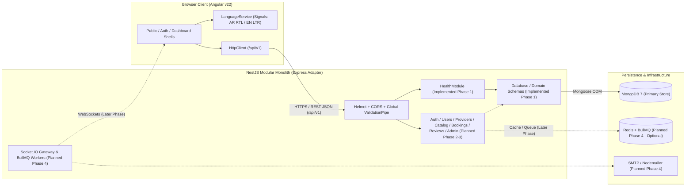

# FixMate — System Architecture & Domain Boundaries

> **Document Status:** Phase 1 Architecture Specification  
> **Implementation Status:** Phase 1 implements the Angular v22 foundation, NestJS core configuration/health module, and Mongoose domain schemas. Business CRUD modules, Redis, BullMQ, and Socket.IO are **planned future layers** and clearly distinguished below.

---

## 1. Architectural Pattern: Modular Monolith

FixMate uses a **Modular Monolith** architecture consisting of:
1. **Frontend Client (`frontend/`):** Angular v22 Single-Page Application (standalone components, Angular Signals, SCSS with CSS logical properties for RTL/LTR, Angular Router, and `HttpClient`).
2. **Backend API (`backend/`):** NestJS application running on the Express HTTP adapter, organized into strictly bounded domain modules under a versioned global prefix (`/api/v1`).
3. **Primary Persistence:** MongoDB accessed through Mongoose (`@nestjs/mongoose`) with module-scoped schema registrations and strict database-level indexes.
4. **Deferred Advanced Infrastructure (Later Phases):** Redis (`ioredis`) for cache-aside lookups, BullMQ (`@nestjs/bullmq`) + Nodemailer for asynchronous email/notification jobs, `@nestjs/schedule` for cron expiration tasks, and Socket.IO (`@nestjs/websockets`) for realtime status updates.

### Why a Modular Monolith Instead of Microservices?
- **Transactional Integrity:** Booking acceptance requires coordinating `bookings`, `provider_slots`, and `booking_events` in a single atomic MongoDB transaction without distributed saga complexity.
- **Zero Premature Network Overhead:** Domain boundaries are enforced via NestJS module exports and TypeScript interfaces rather than internal gRPC/HTTP hops.
- **Operational Simplicity:** Single backend deployment artifact (Docker container on Render) and unified test suite (`jest`).

---

## 2. System Topology Diagram



*Legend:* Solid arrows (`-->`) denote components wired in Phase 1; dashed arrows (`-.->`) denote planned Phase 2–4 integrations.

---

## 3. Backend Module Responsibility Boundaries

| Module | Phase | Primary Responsibilities & Owned Collections |
| :--- | :---: | :--- |
| `ConfigModule` | **Phase 1** | Fails fast on startup if required environment variables (`PORT`, `MONGODB_URI`, `CORS_ORIGINS`, `NODE_ENV`) are invalid or missing. Never logs secrets. |
| `DatabaseModule` | **Phase 1** | Configures `MongooseModule.forRootAsync` and exports domain schema modules for model verification and health readiness checks. |
| `HealthModule` | **Phase 1** | Exposes `GET /api/v1/health`, reporting service uptime, environment mode, UTC timestamp, and safe MongoDB connection state (`connected`/`disconnected`) without leaking URIs or credentials. |
| `AuthModule` | Phase 2 | Registration, login, `bcrypt` password verification, JWT access/refresh token issuance, `JwtAuthGuard`, and `RolesGuard`. |
| `UsersModule` | Phase 2 | Manages `users` and customer `addresses` collections; enforces customer ownership on saved addresses. |
| `ProvidersModule` | Phase 2–3 | Manages `provider_profiles`, `provider_services`, and `provider_slots`; enforces approval status checks (`APPROVED`) for public search. |
| `CatalogModule` | Phase 2 | Read/write operations for `categories` and `services` with localized `ar`/`en` fields and soft deactivation (`isActive`). |
| `BookingsModule` | Phase 3 | Orchestrates `bookings`, `booking_events`, and atomic `provider_slots` locking/releasing according to `BOOKING_LIFECYCLE.md`. |
| `ReviewsModule` | Phase 3 | Manages `reviews` creation (1 per `COMPLETED` booking) and updates provider rating summaries. |
| `NotificationsModule` | Phase 4 | Manages `notifications` persistence, read states, and triggers Socket.IO/BullMQ dispatch. |
| `UploadsModule` | Phase 4 | Handles Multer-validated image uploads (`image/jpeg`, `image/png`, `image/webp`, max 2 MB) with UUID filenames. |
| `AdminModule` | Phase 2–3 | Dedicated administrative workflows: provider approval/suspension, review moderation (`HIDDEN`), and emergency booking cancellation. |

---

## 4. Role Checks vs. Resource-Ownership Checks

A core security principle of FixMate is that **Role-Based Access Control (RBAC) and Resource-Ownership Verification are distinct layers**:

1. **Role Check (`RolesGuard` + `@Roles(...)` decorator — Coarse-Grained):**
   - Answers: *"Is the authenticated user a `CUSTOMER`, `PROVIDER`, or `ADMIN`?"*
   - Enforced at the route guard level before the controller method runs.
   - Example: Only users with `role === UserRole.CUSTOMER` can call `POST /api/v1/bookings`.
2. **Resource-Ownership Check (Service-Layer Policy — Fine-Grained):**
   - Answers: *"Does this specific `CUSTOMER` own booking `:id`, or is this specific `PROVIDER` the assigned provider on booking `:id`?"*
   - Enforced inside the application service when loading the target document (`booking.customerId.equals(actor.userId)`).
   - If a `CUSTOMER` attempts to view or cancel another customer's booking, `RolesGuard` passes (they are a customer), but the service-layer ownership check rejects the request with `403 Forbidden` (or `404 Not Found` to prevent ID enumeration).

---

## 5. Request Lifecycle, Validation, Pagination & Error Contract

### 5.1 Request Pipeline
`Incoming HTTP Request` → `Helmet Security Headers` → `CORS Check` → `Global Prefix (/api/v1)` → `Route Guards (Auth/Roles in Phase 2+)` → `Global ValidationPipe (whitelist, forbidNonWhitelisted, transform)` → `Controller (Thin HTTP transport)` → `Domain Service (Business logic, ownership check, Mongoose queries)` → `JSON Response / Standard NestJS Exception`.

### 5.2 Standard Error Shape
FixMate relies on NestJS standard HTTP exceptions (`BadRequestException`, `UnauthorizedException`, `ForbiddenException`, `NotFoundException`, `ConflictException`, `UnprocessableEntityException`) which serialize predictably:
```json
{
  "statusCode": 400,
  "message": ["requestedStartUtc must be a valid ISO 8601 date string"],
  "error": "Bad Request"
}
```

### 5.3 Standard Pagination Contract (List Endpoints)
Paginated endpoints accept query parameters `page` (default `1`, min `1`) and `limit` (default `20`, max `50`) and return:
```json
{
  "items": [],
  "meta": {
    "page": 1,
    "limit": 20,
    "totalItems": 0,
    "totalPages": 0
  }
}
```

---

## 6. Public Projections & Deliberate Privacy Limits

To protect user safety and privacy in a residential home-services marketplace:
- **Customer Residential Addresses (`addresses` and `bookings.addressSnapshot`):** Never exposed on public endpoints. Even for providers, the customer's full street/building/phone snapshot is only accessible to the **assigned** provider on their own booking detail view.
- **Authentication Secrets (`passwordHash`, refresh token hashes):** Marked `select: false` at the Mongoose schema level and stripped from all DTO projections.
- **Provider Verification Internals:** Public provider profiles expose only `PublicProviderSummary` (display name, bio, years of experience, coverage governorates/areas, approved badge, services offered, and aggregated rating). Internal admin notes, rejection reasons, and raw account email/status histories remain restricted to the provider owner and `ADMIN`.
- See `docs/01-product/API_CONTRACT_DRAFT.md` for the full preliminary endpoint inventory.
