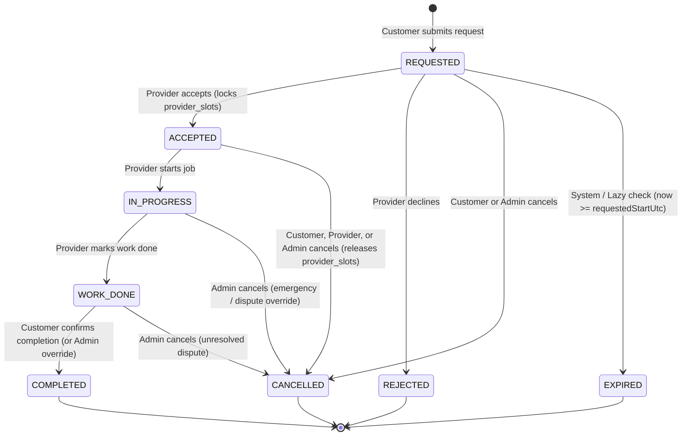

# FixMate — Booking Lifecycle & Capacity Invariants

> **Document Status:** Phase 1 Specification & Domain Contract  
> **Implementation Status:** The state machine enum (`BookingStatus`) and pure transition validation helper are implemented in `backend/src/common/domain/booking-status.ts` and unit-tested in Phase 1. Booking HTTP endpoints are **not yet implemented** (reserved for Phase 3).

---

## 1. Canonical Booking States (`BookingStatus`)

Every booking document in `bookings` exists in exactly one of the following 8 states:

| State | Terminal? | Capacity Locked? | Description |
| :--- | :---: | :---: | :--- |
| `REQUESTED` | No | **No** | Submitted by a customer for a specific approved provider, service, and UTC window. Awaiting provider response. |
| `ACCEPTED` | No | **Yes** | Accepted by the assigned provider. Discrete 30-minute `provider_slots` for `[confirmedStartUtc, confirmedEndUtc)` are atomically locked. |
| `IN_PROGRESS` | No | **Yes** | Provider has arrived/started executing the maintenance work. Self-service cancellation by customer or provider is locked out. |
| `WORK_DONE` | No | **Yes** (Historical) | Provider has finished physical execution and recorded final notes/agreed amount in `fils`. Awaiting customer confirmation. |
| `COMPLETED` | **Yes** | No (Historical) | Customer has confirmed completion of `WORK_DONE`. Unlocks eligibility for one customer review (`reviews`). |
| `REJECTED` | **Yes** | No | Provider explicitly declined a `REQUESTED` booking before accepting it. |
| `CANCELLED` | **Yes** | No (Released) | Booking was cancelled by Customer (from `REQUESTED`/`ACCEPTED`), by Provider (from `ACCEPTED` with mandatory reason), or by Admin (from any non-terminal state). Any locked `provider_slots` are released. |
| `EXPIRED` | **Yes** | No | A `REQUESTED` booking was not accepted before `requestedStartUtc` (or configured SLA cutoff) elapsed. |

---

## 2. State Machine Diagram



---

## 3. Canonical Transition Matrix

All transitions are enforced server-side. Any transition not listed below is rejected with `400 Bad Request` / `422 Unprocessable Entity`.

| From State | To State | Allowed Actor(s) | Required Preconditions | Side Effects & Audit (`booking_events`) |
| :--- | :--- | :--- | :--- | :--- |
| `(none)` | `REQUESTED` | `CUSTOMER` | Customer `ACTIVE`; Provider `APPROVED` & `ACTIVE`; Service & `provider_services` active; `requestedStartUtc > now + 60m`; valid 30m slot alignment. | Create `bookings` doc with immutable address, service, and pricing snapshots; insert `CREATED` event in `booking_events`. |
| `REQUESTED` | `ACCEPTED` | `PROVIDER` (assigned) | Provider `APPROVED` & `ACTIVE`; `now < requestedStartUtc`; all 30m slots in `[requestedStartUtc, requestedEndUtc)` are free for this provider. | Atomically insert/lock `provider_slots` for all 30m intervals in window; set `confirmedStartUtc`/`confirmedEndUtc`; insert `STATUS_CHANGED` event. |
| `REQUESTED` | `REJECTED` | `PROVIDER` (assigned) | Provider owns `providerProfileId` on booking; non-empty rejection reason provided. | Set `rejectedAt`, `rejectionReason`; insert `STATUS_CHANGED` event. |
| `REQUESTED` | `CANCELLED` | `CUSTOMER` (owner), `ADMIN` | Actor is booking's `customerId` or an `ADMIN`. | Set `cancelledAt`, `cancelledByRole`, `cancellationReason`; insert `STATUS_CHANGED` event. |
| `REQUESTED` | `EXPIRED` | `SYSTEM`, `ADMIN` | `now >= requestedStartUtc` (or response timeout reached) while status is still `REQUESTED`. | Set `expiredAt`; insert `STATUS_CHANGED` event. |
| `ACCEPTED` | `IN_PROGRESS` | `PROVIDER` (assigned) | Provider owns `providerProfileId` on booking; account `ACTIVE`. | Set `startedAt`; insert `STATUS_CHANGED` event. |
| `ACCEPTED` | `CANCELLED` | `CUSTOMER` (owner), `PROVIDER` (assigned), `ADMIN` | Actor is owner `customerId`, assigned `providerProfileId` (must supply reason), or `ADMIN`. | Atomically delete/release locked `provider_slots` for this `bookingId`; set `cancelledAt`, `cancelledByRole`, `cancellationReason`; insert `STATUS_CHANGED` event. |
| `IN_PROGRESS` | `WORK_DONE` | `PROVIDER` (assigned) | Provider owns `providerProfileId` on booking; optional `agreedAmountFils` (if set, integer `>= 0`). | Set `workDoneAt` and update `pricingSnapshot.agreedAmountFils` if provided; insert `STATUS_CHANGED` event. |
| `IN_PROGRESS` | `CANCELLED` | `ADMIN` | Admin provides mandatory administrative intervention reason. | Release any future `provider_slots`; set `cancelledAt`, `cancelledByRole: 'ADMIN'`, `cancellationReason`; insert `ADMIN_INTERVENTION` event. |
| `WORK_DONE` | `COMPLETED` | `CUSTOMER` (owner), `ADMIN` | Actor is booking's `customerId` (or `ADMIN` resolving an unconfirmed job). | Set `completedAt`; unlock review eligibility; insert `STATUS_CHANGED` event. |
| `WORK_DONE` | `CANCELLED` | `ADMIN` | Customer raised an offline dispute that Admin verified as unfulfilled work; mandatory admin reason. | Set `cancelledAt`, `cancelledByRole: 'ADMIN'`, `cancellationReason`; insert `ADMIN_INTERVENTION` event. |

---

## 4. Explicit V1 Decisions on `WORK_DONE`, Rescheduling & Quotes

1. **Why `WORK_DONE` Exists Distinct from `COMPLETED`:**
   - Providers should not be able to unilaterally mark a job `COMPLETED` to unlock or fabricate self-reviews.
   - The provider marks `WORK_DONE` when physical maintenance finishes. The customer then confirms `WORK_DONE` → `COMPLETED`.
2. **Dispute Handling on `WORK_DONE` (V1 Decision):**
   - V1 does **not** include a separate `DISPUTED` state or automated escrow arbitration because V1 has no online payment processing.
   - If a customer disagrees that work was satisfactorily completed, they refrain from confirming `COMPLETED` and contact support/admin. An `ADMIN` can inspect `booking_events` and transition `WORK_DONE` → `CANCELLED` (preventing review fabrication) or `WORK_DONE` → `COMPLETED` if completion is verified.
   - *Future Expansion (Post-V1):* A dedicated `DISPUTED` sub-workflow can be introduced if online escrow payments are added in V2.
3. **Rescheduling Boundary (V1 Decision):**
   - V1 does **not** support in-place mutation of `confirmedStartUtc` / `confirmedEndUtc` on an `ACCEPTED` booking. If a different time window is needed, the booking is `CANCELLED` (releasing its `provider_slots`) and a new booking request is submitted.
4. **Quote & Pricing Representation:**
   - Every service and provider-service defines a `PricingType`:
     - `FIXED`: Fixed price for a standard task (e.g., `15000` fils = `15.000 JOD`).
     - `STARTING_AT`: Base starting price (`startingPriceFils`), with final quote determined after on-site inspection.
     - `INSPECTION_ONLY`: Fixed call-out/inspection fee (`inspectionFeeFils`), where repair work is quoted separately on-site.
   - All amounts are stored as **integer minor units (`fils`)**.

---

## 5. Time Storage & Localization Rules

1. **Persistence (`UTC` Only):**
   - All timestamps in MongoDB (`requestedStartUtc`, `requestedEndUtc`, `confirmedStartUtc`, `confirmedEndUtc`, `slotStartUtc`, `slotEndUtc`, and lifecycle timestamps) are stored as `Date` objects in UTC.
2. **Slot Alignment:**
   - Time slots use a fixed **30-minute granularity**. Valid slot boundaries have minutes equal to `00` or `30`, seconds `00`, and milliseconds `000` in UTC.
3. **Display (`Asia/Amman`):**
   - The Angular frontend formats all UTC timestamps using the `Asia/Amman` IANA timezone (UTC+03:00) and the active locale (`ar-JO` or `en-JO`).

---

## 6. Single Capacity Invariant & Race-Condition Protection

### 6.1 The Invariant
> **Pending requests (`REQUESTED`) never reserve capacity; accepted bookings (`ACCEPTED`, `IN_PROGRESS`) must never overlap for the same provider.**

### 6.2 Why `providerId + startAt` Alone Is Insufficient
A simple unique index on `{ providerProfileId, confirmedStartUtc }` **fails** to prevent overlapping variable-duration bookings. For example:
- Booking 1: `10:00–12:00 UTC` (`startAt = 10:00`)
- Booking 2: `11:00–13:00 UTC` (`startAt = 11:00`)
Both have different `startAt` values, so a naive `{ providerProfileId, startAt }` index would allow both to be accepted even though they overlap between `11:00` and `12:00`!

### 6.3 Atomic Discrete Slot Reservation (`provider_slots`)
To guarantee zero overlap across arbitrary multi-slot bookings without relying on frontend checks:
1. Every booking window `[startUtc, endUtc)` is decomposed into contiguous **30-minute discrete slots**:
   - Example: `10:00–11:30 UTC` decomposes into three slots: `10:00`, `10:30`, and `11:00`.
2. The `provider_slots` collection enforces a **database-level unique compound index**:
   ```ts
   { providerProfileId: 1, slotStartUtc: 1 } // unique: true
   ```
3. When a provider accepts a `REQUESTED` booking for `[startUtc, endUtc)`:
   - Within a MongoDB transaction (on a replica set / Atlas) or ordered atomic batch insert, the backend inserts one `provider_slots` document per 30-minute bucket (`slotStartUtc`, `slotEndUtc`, `providerProfileId`, `bookingId`).
   - If **any** 30-minute bucket in that range is already occupied by another accepted booking, MongoDB immediately throws duplicate key error `E11000` on `{ providerProfileId, slotStartUtc }`.
   - The transaction aborts (or compensating cleanup deletes any partially inserted slots for that `bookingId` if running in standalone fallback mode), and the API returns `409 Conflict`.
4. When an `ACCEPTED` booking is `CANCELLED`, its associated `provider_slots` documents (`{ bookingId }`) are deleted, immediately freeing those 30-minute buckets for future bookings.
