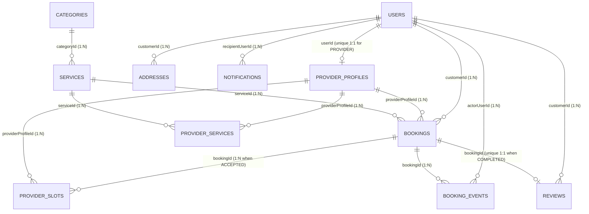

# FixMate — MongoDB Data Model, Constraints & Index Strategy

> **Document Status:** Phase 1 Persistence Foundation  
> **Implementation Status:** All 11 Mongoose schemas, TypeScript domain contracts, validators, and database-level indexes described below are implemented in `backend/src/database/schemas/` and `backend/src/common/domain/` and verified via automated tests in Phase 1. Business CRUD controllers are **not yet implemented**.

---

## 1. Entity-Relationship Overview

FixMate models its persistence layer across **11 dedicated MongoDB collections** (the 10 core collections required by the specification plus `provider_slots` for atomic conflict-free capacity reservation):

---

## 2. Collection-by-Collection Specification

### 2.1 `users` (`User`)
- **Purpose:** Core identity, role (`CUSTOMER`, `PROVIDER`, `ADMIN`), and account lifecycle state (`ACTIVE`, `SUSPENDED`, `DEACTIVATED`).
- **Notable Fields:**
  - `email` (required, lowercase, trimmed, unique)
  - `fullName` (required, 2–120 chars)
  - `phone` (optional/required on onboarding, trimmed)
  - `passwordHash` (required string placeholder for Phase 2 bcrypt hash, `select: false` by default so queries never accidentally return it)
  - `role` (`UserRole`: `CUSTOMER` | `PROVIDER` | `ADMIN`, default `CUSTOMER`)
  - `status` (`AccountStatus`: `ACTIVE` | `SUSPENDED` | `DEACTIVATED`, default `ACTIVE`)
  - `preferredLanguage` (`ar` | `en`, default `ar`)
- **Indexes:**
  - `{ email: 1 }` — **Unique** (prevents duplicate registrations)
  - `{ role: 1, status: 1 }` — Admin user filtering

### 2.2 `provider_profiles` (`ProviderProfile`)
- **Purpose:** Professional profile, coverage areas, weekly availability windows, and admin verification workflow for a `PROVIDER` user.
- **Notable Fields:**
  - `userId` (`ObjectId` ref `User`, **unique**)
  - `displayName` (required, 2–120 chars)
  - `bio` (`LocalizedText`: `{ ar, en }`)
  - `yearsOfExperience` (integer, `0`–`60`)
  - `coverageGovernorates` (`string[]`, e.g., `['amman', 'zarqa']`)
  - `coverageAreas` (`string[]`, e.g., `['abdoun', 'khalda', 'sweifieh']`)
  - `weeklyAvailability` (`AvailabilityWindow[]`: `{ dayOfWeek: 0..6, startMinuteOfDay: 0..1410, endMinuteOfDay: 30..1440 }` in `Asia/Amman` local schedule terms)
  - `approvalStatus` (`ProviderApprovalStatus`: `DRAFT` | `PENDING_REVIEW` | `APPROVED` | `REJECTED` | `SUSPENDED`, default `DRAFT`)
  - `approvalMetadata` (subdocument: `submittedAt`, `reviewedAt`, `reviewedByUserId`, `rejectionOrSuspensionReason`, `verificationNotes` — `select: false` on internal notes in public projections)
  - `averageRating` (`0`–`5`, default `0`) and `reviewCount` (integer `>= 0`, default `0`)
- **Indexes:**
  - `{ userId: 1 }` — **Unique** (one provider profile per user)
  - `{ approvalStatus: 1, coverageGovernorates: 1 }` — Public marketplace discovery query

### 2.3 `categories` (`Category`)
- **Purpose:** Top-level home-maintenance taxonomy (`plumbing`, `electrical-repairs`, `ac-maintenance`, `cleaning`, `painting`, `carpentry`).
- **Notable Fields:**
  - `slug` (required, lowercase URL-safe slug, **unique**)
  - `name` (`LocalizedText`: `{ ar, en }`)
  - `description` (`LocalizedText`: `{ ar, en }`)
  - `iconName` (string identifier)
  - `displayOrder` (integer `>= 0`)
  - `isActive` (boolean, default `true` — soft deactivation instead of hard delete)
- **Indexes:**
  - `{ slug: 1 }` — **Unique**
  - `{ isActive: 1, displayOrder: 1 }` — Public catalog sorting

### 2.4 `services` (`Service`)
- **Purpose:** Specific bookable maintenance services within a category.
- **Notable Fields:**
  - `categoryId` (`ObjectId` ref `Category`, required)
  - `slug` (required, lowercase URL-safe slug, **unique**)
  - `title` (`LocalizedText`: `{ ar, en }`)
  - `description` (`LocalizedText`: `{ ar, en }`)
  - `pricingPolicy` (`ServicePricingPolicy`: `pricingType` in `FIXED` | `STARTING_AT` | `INSPECTION_ONLY`, `indicativeAmountFils` integer `>= 0`, `currency: 'JOD'`)
  - `defaultDurationMinutes` (integer, multiple of `30`, `60`–`480`, default `60`)
  - `isActive` (boolean, default `true`)
- **Indexes:**
  - `{ slug: 1 }` — **Unique**
  - `{ categoryId: 1, isActive: 1 }` — Category service listing

### 2.5 `provider_services` (`ProviderServiceOffering`)
- **Purpose:** Join collection linking an approved provider profile to the specific services they offer, with provider-specific pricing in `fils`.
- **Notable Fields:**
  - `providerProfileId` (`ObjectId` ref `ProviderProfile`, required)
  - `serviceId` (`ObjectId` ref `Service`, required)
  - `pricingType` (`PricingType`: `FIXED` | `STARTING_AT` | `INSPECTION_ONLY`)
  - `priceAmountFils` (integer `>= 0`, validated via `Number.isInteger`)
  - `estimatedDurationMinutes` (integer, multiple of `30`, `60`–`480`)
  - `isEnabled` (boolean, default `true`)
- **Indexes:**
  - `{ providerProfileId: 1, serviceId: 1 }` — **Unique** (a provider configures at most one offering per catalog service)
  - `{ serviceId: 1, isEnabled: 1 }` — Filtering providers who offer a given service

### 2.6 `addresses` (`Address`)
- **Purpose:** Customer-owned manual Jordanian residential/office addresses.
- **Notable Fields:**
  - `customerId` (`ObjectId` ref `User`, required)
  - `label` (optional string, e.g., `"Home"`, `"المنزل"`)
  - `governorate` (required string, e.g., `"Amman"`)
  - `cityOrDistrict` (required string, e.g., `"Abdoun"`)
  - `street` (required string)
  - `building` (required string)
  - `floorOrApartment` (optional string)
  - `landmark` (optional string — crucial for Jordanian addressing)
  - `contactPhone` (required string)
  - `isDefault` (boolean, default `false`)
  - `isActive` (boolean, default `true` — soft deletion)
- **Indexes:**
  - `{ customerId: 1, isActive: 1, createdAt: -1 }` — Loading a customer's saved address book

### 2.7 `bookings` (`Booking`)
- **Purpose:** Canonical record of a service booking request and its execution lifecycle.
- **Notable Fields:**
  - `customerId` (`ObjectId` ref `User`, required)
  - `providerProfileId` (`ObjectId` ref `ProviderProfile`, required)
  - `serviceId` (`ObjectId` ref `Service`, required)
  - `serviceSnapshot` (immutable embedded snapshot: `{ slug, titleAr, titleEn, categorySlug }`)
  - `addressSnapshot` (immutable embedded snapshot of the Jordanian address at booking creation)
  - `pricingSnapshot` (immutable embedded snapshot: `{ pricingType, quotedAmountFils, agreedAmountFils?, currency: 'JOD' }`)
  - `requestedStartUtc` (`Date`, required) & `requestedEndUtc` (`Date`, required)
  - `confirmedStartUtc` (`Date`, optional) & `confirmedEndUtc` (`Date`, optional)
  - `status` (`BookingStatus` enum, default `REQUESTED`)
  - `customerNotes`, `providerNotes`, `cancellationReason`, `cancelledByRole`, lifecycle timestamps (`acceptedAt`, `startedAt`, `workDoneAt`, `completedAt`, `cancelledAt`, `rejectedAt`, `expiredAt`)
- **Indexes:**
  - `{ customerId: 1, status: 1, createdAt: -1 }` — Customer booking dashboard queries
  - `{ providerProfileId: 1, status: 1, requestedStartUtc: 1 }` — Provider booking queue & schedule queries

### 2.8 `provider_slots` (`ProviderSlot`)
- **Purpose:** Atomic 30-minute capacity reservation buckets for `ACCEPTED` / `IN_PROGRESS` bookings.
- **Distinction from `weeklyAvailability`:**
  - `provider_profiles.weeklyAvailability` defines the provider's **general operating hours** (e.g., Sunday–Thursday 09:00–17:00 Amman time).
  - `provider_slots` represents **occupied capacity locked by an accepted booking**.
- **Notable Fields:**
  - `providerProfileId` (`ObjectId` ref `ProviderProfile`, required)
  - `bookingId` (`ObjectId` ref `Booking`, required)
  - `slotStartUtc` (`Date`, required — aligned to `:00` or `:30` UTC)
  - `slotEndUtc` (`Date`, required — `slotStartUtc + 30 minutes`)
- **Conflict-Proof Index & Atomic Write Strategy:**
  - `{ providerProfileId: 1, slotStartUtc: 1 }` — **Unique Compound Index**.
  - `{ bookingId: 1 }` — Fast lookup/release of all slots belonging to a booking when cancelled.
  - Because every booking window `[startUtc, endUtc)` is decomposed into contiguous 30-minute slots via `decomposeWindowIntoSlots()`, any partial or total overlap between two bookings for the same provider collides on at least one `{ providerProfileId, slotStartUtc }` document and is rejected by MongoDB (`E11000` duplicate key).

### 2.9 `booking_events` (`BookingEvent`)
- **Purpose:** Append-only audit log of every state transition and administrative action on a booking.
- **Notable Fields:**
  - `bookingId` (`ObjectId` ref `Booking`, required)
  - `actorUserId` (`ObjectId` ref `User`, optional for `SYSTEM` expiration)
  - `actorRole` (`CUSTOMER` | `PROVIDER` | `ADMIN` | `SYSTEM`, required)
  - `eventKind` (`BookingEventKind`: `CREATED` | `STATUS_CHANGED` | `ADMIN_INTERVENTION`)
  - `fromStatus` (`BookingStatus`, optional) & `toStatus` (`BookingStatus`, required)
  - `reason` (optional string — sanitized, never stores sensitive tokens/addresses)
  - `occurredAt` (`Date`, default `Date.now`)
- **Indexes:**
  - `{ bookingId: 1, occurredAt: 1 }` — Chronological audit timeline per booking

### 2.10 `reviews` (`Review`)
- **Purpose:** Verified post-completion customer review (`1–5` stars).
- **Notable Fields:**
  - `bookingId` (`ObjectId` ref `Booking`, required, **unique**)
  - `customerId` (`ObjectId` ref `User`, required)
  - `providerProfileId` (`ObjectId` ref `ProviderProfile`, required)
  - `rating` (integer, `min: 1`, `max: 5`, validated via `Number.isInteger`)
  - `comment` (optional string, max `1000` chars)
  - `moderationStatus` (`ReviewModerationStatus`: `VISIBLE` | `HIDDEN`, default `VISIBLE`)
  - `moderatedByUserId` (`ObjectId` ref `User`, optional) & `moderationReason` (optional string)
- **Indexes:**
  - `{ bookingId: 1 }` — **Unique** (enforces strictly one review per booking at the database level)
  - `{ providerProfileId: 1, moderationStatus: 1, createdAt: -1 }` — Public provider review feed

### 2.11 `notifications` (`Notification`)
- **Purpose:** In-app user notifications for booking updates and account status changes.
- **Notable Fields:**
  - `recipientUserId` (`ObjectId` ref `User`, required)
  - `type` (`NotificationType`: `BOOKING_REQUESTED` | `BOOKING_ACCEPTED` | `BOOKING_REJECTED` | `BOOKING_CANCELLED` | `BOOKING_WORK_DONE` | `BOOKING_COMPLETED` | `PROVIDER_APPROVAL_UPDATED` | `REVIEW_RECEIVED`)
  - `title` (`LocalizedText`: `{ ar, en }`)
  - `body` (`LocalizedText`: `{ ar, en }`)
  - `relatedResourceType` (`BOOKING` | `PROVIDER_PROFILE` | `REVIEW`)
  - `relatedResourceId` (`ObjectId`, optional)
  - `isRead` (boolean, default `false`)
  - `readAt` (`Date`, optional)
- **Indexes:**
  - `{ recipientUserId: 1, isRead: 1, createdAt: -1 }` — Unread notification badge & inbox feed

---

## 3. Embedding vs. Referencing Rationale

| Relationship | Chosen Pattern | Justification |
| :--- | :--- | :--- |
| **Localized Text (`{ ar, en }`)** on Categories, Services, Notifications | **Embedded Subdocument** | Always fetched and updated atomically with the parent entity; bounded size (2 keys). |
| **Booking Address, Service Title & Pricing (`addressSnapshot`, `serviceSnapshot`, `pricingSnapshot`)** | **Reference (`serviceId`) + Immutable Embedded Snapshot** | If a customer later edits their saved address in `addresses` or a provider changes their price in `provider_services`, historical and active bookings must retain the exact terms and location agreed upon at request time (`BR-06`). |
| **Booking Audit Trail (`booking_events`)** | **Separate Collection (Referenced by `bookingId`)** | Keeps `bookings` document writes focused on current state while allowing append-only audit querying without growing the main booking document indefinitely. |
| **Occupied Capacity (`provider_slots`)** | **Separate Collection (Referenced by `providerProfileId` & `bookingId`)** | Allows MongoDB to enforce a unique compound index `{ providerProfileId: 1, slotStartUtc: 1 }` across individual 30-minute buckets and delete them cleanly upon cancellation. |

---

## 4. Data Lifecycle, Soft Deactivation & Privacy Notes

1. **No Cascading Hard Deletes on Catalog or Profiles:** Categories (`categories`), services (`services`), users (`users`), and provider profiles (`provider_profiles`) use soft-deactivation flags (`isActive: false` or `status: 'SUSPENDED'`). Historical bookings remain intact.
2. **Customer Address Privacy:** Customer residential addresses (`addresses` and `bookings.addressSnapshot`) are restricted to the owning customer, the assigned provider of that specific booking, and platform admins. They are never included in public provider reviews or catalog responses.
3. **Credential Protection:** `users.passwordHash` is configured with `select: false` in the Mongoose schema definition so default queries exclude it automatically.
