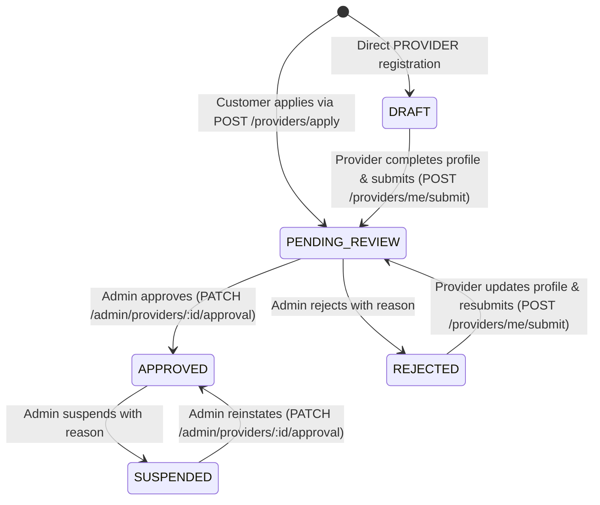

# FixMate — Provider Onboarding, Approval & Offerings Specification (`Part 07`)

> **Document Status:** `IMPLEMENTED` in Phase 2 (Part 07)

---

## 1. Onboarding Paths & Role Semantics

FixMate supports **two controlled entry paths** into provider onboarding, both converging on the exact same admin approval gate:

1. **Path A — Direct Provider Registration (`POST /api/v1/auth/register` with `role: 'PROVIDER'`):**
   - Creates an active `User` with `role: UserRole.PROVIDER` and immediately initializes a `provider_profiles` document in `DRAFT` status.
2. **Path B — Customer-to-Provider Application (`POST /api/v1/providers/apply`):**
   - An authenticated `CUSTOMER` submits their initial professional profile details (`displayName`, `bio`, `yearsOfExperience`, `coverageGovernorates`, `coverageAreas`, `weeklyAvailability`).
   - The backend creates their `provider_profiles` document in `PENDING_REVIEW` status (`approvalMetadata.submittedAt = now`) and updates `user.role = UserRole.PROVIDER`.

In **neither** path can a user self-approve (`APPROVED`) or elevate to `ADMIN`.

---

## 2. Provider Approval Lifecycle (`ProviderApprovalStatus`)

### Transition & Resubmission Rules
- **`DRAFT` → `PENDING_REVIEW`:** Requires non-empty bilingual bio (`ar` and `en`), `displayName`, at least 1 coverage governorate (`coverageGovernorates`), and at least 1 coverage area (`coverageAreas`).
- **`REJECTED` → `PENDING_REVIEW`:** Rejected providers may edit their profile to address the admin's `rejectionOrSuspensionReason` and call `POST /api/v1/providers/me/submit` to re-enter the `PENDING_REVIEW` queue.
- **`APPROVED` Profile Edits:** An `APPROVED` provider may update their bio, coverage areas, working hours (`weeklyAvailability`), and service offerings (`provider_services`). They **cannot** modify `approvalStatus` or `approvalMetadata`.
- **Immediate Removal on `SUSPENDED`:** When an admin transitions a provider to `SUSPENDED` (or suspends their `User` account), the provider immediately disappears from `GET /api/v1/providers` and `GET /api/v1/providers/:id` (`404 Not Found`).

---

## 3. Approval vs. Qualification Verification (Truthful Representation)

Per FixMate product rules:
- Admin `APPROVED` status means the provider's marketplace listing has been reviewed and approved by FixMate administration to appear in the directory.
- It does **not** claim government licensing, criminal background clearance, or physical document notarization in Phase 2 (file uploads via Multer are deferred to Phase 4). UI badges use truthful labels: **"Approved Listing / مزود معتمد في المنصة"**.

---

## 4. Provider Offerings (`provider_services`) & Working Hours

1. **Service Offerings (`/api/v1/providers/me/services`):**
   - Providers can only attach catalog services that exist and have `isActive: true`.
   - Each offering specifies:
     - `pricingType`: `FIXED` | `STARTING_AT` | `INSPECTION_ONLY`
     - `priceAmountFils`: non-negative integer in JOD minor units (`1 JOD = 1000 fils`)
     - `estimatedDurationMinutes`: integer multiple of `30` between `60` and `480` minutes
     - `isEnabled`: boolean
2. **Published Working Hours vs. Phase 3 Appointment Slots:**
   - `provider_profiles.weeklyAvailability` stores the provider's **general published working hours** in `Asia/Amman` local schedule terms (`dayOfWeek: 0..6`, `startMinuteOfDay`, `endMinuteOfDay` in 30-minute multiples).
   - Actual conflict-free appointment locking (`provider_slots`) occurs only when bookings are accepted in Phase 3.
